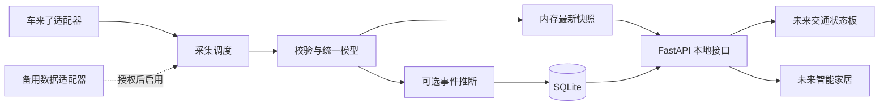
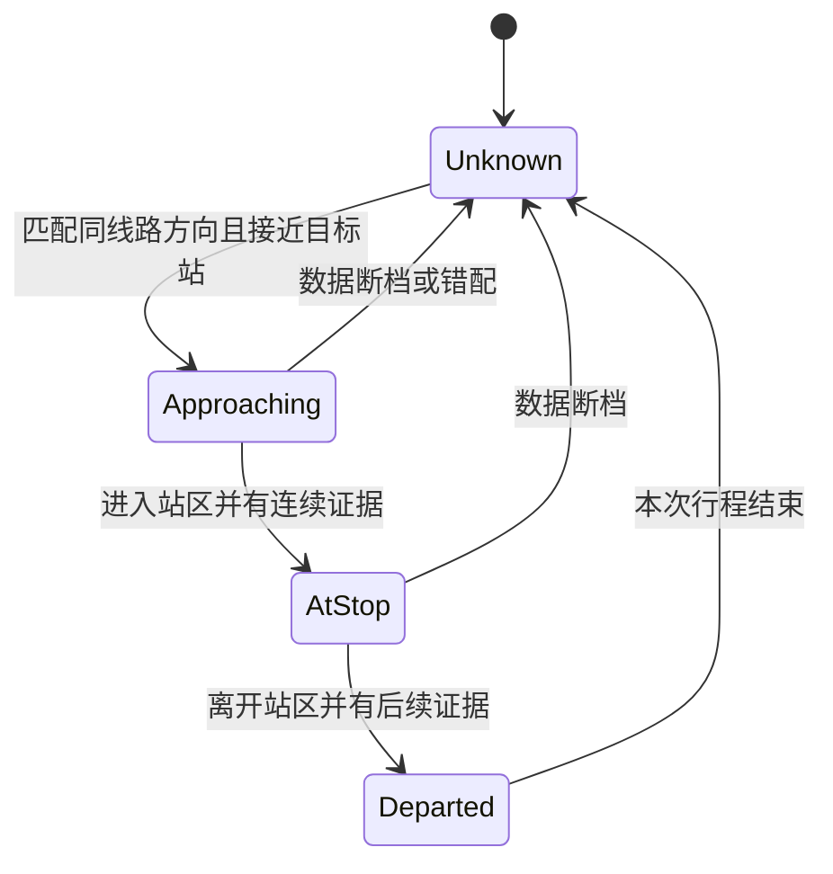

# 书房交通观测站｜公交数据模块实施计划书

> **版本**：v1.0 · 2026-11-25  
> **性质**：独立后端模块技术方案 / 开发与验收依据  
> **部署目标**：绿联 DH4300 Plus NAS（ARM64，Docker Compose；实际架构与运行环境以设备检测为准）  
> **实施状态**：方案设计完成；具体站台、线路 ID、实时字段完整性及长期使用权限待验证

## 0. 项目摘要

本项目围绕成都龙泉驿区书房地铁站、吾悦广场周边的 **桃都大道北京路口公交站**，构建一个可长期维护的独立公交数据服务。

第一阶段不开发交通状态板，也不接入地铁和红绿灯。先打通「数据获取 → 统一格式 → 本地查询 → 数据质量验证 → 可选历史事件」，最终提供与上游平台解耦的本地 API。后续地铁模块打通后，状态板只需消费各模块的标准化数据，不需要直接调用第三方平台。

**最核心的验收问题**：能否查询这个站台上指定线路、指定方向的下一班车预计还有多少秒到站？答案在接口设计层面是可以；具体站台的实时覆盖、准确性和持续可用性必须通过样本验证。

### 0.1 关键设计决策

| 决策 | 选择 | 原因 |
|---|---|---|
| 主数据源候选 | chelaile-api-server（车来了非官方封装，自建） | 有站台、线路、车辆、ETA 查询能力，可替换上游适配器 |
| 快速验证候选 | Code410 实时公交 | 参数简单，适合验证站名与到站信息，不承诺长期服务 |
| 开发语言 | Python 3.12 + FastAPI + httpx | 易于维护，便于后续与其他交通模块集成 |
| 存储 | SQLite，WAL | 单站点负载小，不必引入独立数据库服务 |
| 调用方式 | REST JSON | 未来状态板及 Home Assistant 可直接消费 |
| 部署 | Docker Compose | 适合长期运行的 NAS |
| 运行原则 | 先授权、再实测、后持续采集 | 不绕过访问限制，不用虚假 ETA 填补缺失 |

> 本文中的本地 API、数据模型、阈值、代码骨架均为拟建方案，尚未实现；第三方接口参数依据公开文档整理，不能视为实际返回结果。用户已反馈公交信息可以获取，但本次未取得其真实响应样本。

## 1. 实施范围与优先级

### 1.1 监测对象

- 城市：四川省成都市，龙泉驿区。
- 站名：桃都大道北京路口（地图上可能附带“站”字）。
- 主站点索引：高德 POI `BV10947313`，仅用于辅助核对地理位置。
- 车来了城市标识：`007`（初始化时再次核验城市目录，按字符串保存）。
- 监测双向站台，分别记录终点方向；同名站台不可合并成一个物理站台。
- 线路候选：L026、L056、L052、全日快线等；以实际站台 API 返回和当期运营信息为准，不固定写死。

**注意线路调整**：截至 2026-11-25 的检索中，同一高德 POI 的不同索引版本出现 L026、L056 与 L026、L052、全日快线等不同线路列表。不能把任何一个列表当作当前完整线路清单；发现阶段应枚举两侧物理站台、逐条核实，最终由用户选择关注线路。L052 与“全日快线3路”可能为同一线路的不同称呼，须按实际线路 ID 和运营方向判定，不能只按名称去重。

### 1.2 功能范围

| 优先级 | 功能 | 完成条件 |
|---|---|---|
| P0 | 站台与线路发现 | 确认物理站台、方向、线路 ID、站点 ID、站序 |
| P0 | 最近一班实时 ETA | 返回预计到站时间、剩余秒数、数据更新时间 |
| P0 | 多线路统一查询 | 两侧站台独立显示，明确线路终点 |
| P0 | 数据状态与失败处理 | 无车、无预测、过期、接口错误均有独立状态 |
| P0 | NAS 后端服务 | ARM64 上可启动、重启恢复、可通过局域网查询 |
| P1 | 公交车辆动态 | 有数据时获取位置、剩余距离、剩余站数 |
| P1 | 第二班车 | 上游存在有效 ETA 才显示，否则标为未知 |
| P1 | 到站/离站事件 | 位置或明确站点状态足够且验证通过后启用，标注估算 |
| P1 | 历史到站记录 | 授权允许后保存、检索和自动清理 |
| P2 | Home Assistant / MQTT | 保留接入能力，状态板阶段再开发 |

不在本期范围：交通状态板 UI、地铁实时到站、红绿灯读秒、全城车辆跟踪、自动路线规划、车牌展示、公开数据转发服务。

## 2. 数据源及可用性

### 2.1 来源评估

| 数据源 | 主要用途 | 限制 | 决策 |
|---|---|---|---|
| [chelaile-api-server][1] | 站点、线路、实时车辆与 ETA | 非运营方官方 API；上游可能变化或限制访问 | 首选技术验证候选，确认授权后长期使用 |
| [Code410][2] | 城市 + 站名直接查询 | 方向语义、字段质量、来源授权、稳定性需核实 | 快速交叉验证；经许可才可作为备用 |
| 高德地图站点页 [3] | 核对位置及线路候选 | 地图数据可能滞后；并非实时公交接口 | 只做辅助校验 |
| 成都公交官方或地方开放数据 | 潜在正式数据来源 | 暂未确认有可直接调用的本站实时接口 | 优先争取正式授权；可通过适配器替换 |

开源代码许可证只适用于代码本身，不代表上游公交数据可以任意采集、缓存、转发或商用。自建服务也不意味着摆脱上游调用限制。若无法确认许可和配额，停止计划中的持续采集，保留本地模拟测试及数据接口定义。

### 2.2 可获取字段与真实局限

| 字段 | 来源/映射 | 可信度及处理 |
|---|---|---|
| 线路、终点 | `lineId`, `name`, `endSn` | 上游提供；站台发现时核对 |
| 首末班 | `firstTime`, `lastTime` | 通常为线路始发时间，不当作本站到站时间 |
| 目标站台/线路站点 | `physicalStId`, `sId`, `targetOrder` | 三者语义不同，不能混用 |
| 实时预计剩余时间 | `eta.travelTime`（秒） | 可能为空；仅有效且新鲜时使用 |
| 预计到站绝对时间 | `eta.arrivalTime`（Unix 毫秒） | 转为 ISO 8601；校验合理性 |
| 车辆距离 | `distanceToWaitStn` / `distanceToDest` | 取值语义、单位按对应接口与样本验证 |
| 车辆位置 | `lat`, `lng` | 坐标系需验证，不能混用 WGS-84 与 GCJ-02 |
| 车辆站序 | `order` | 在站/下一站含义需实测，不能直接当作剩余站数 |
| 速度与拥挤 | `speed`, `capacity` | 单位和枚举未验证前不展示 |
| 车辆标识 | `busId` | 可能随行程变化，不能假设永久稳定 |
| 发车时刻 | `preArrivalTime`, `depDesc`, timetable | 仅可标注预计发车/计划发车，不视为本站 ETA |
| 第二班 ETA | `buses[].eta` | 经常缺失；绝不将缺失值当 0 秒 |
| 实际进出站 | 本地事件推算 | 不是运营方原始日志；允许无法判定 |

文档指出实时线路接口主要为最接近目标站的车辆生成 ETA；其他车辆可有位置而没有 ETA。因此本项目 P0 以“最近一班车”作为目标，不承诺所有车辆的到站预测。

## 3. 阶段一：接口验证手册（先做这一步）

在 NAS 的 SSH 终端或本地开发电脑中运行。所有测试仅用于低频验证，遵守服务条款。以下 curl 命令需要网络与 curl；jq 为可选 JSON 查看工具。测试公共实例时不使用家庭住址、不传用户位置，只传公共公交站点信息。

### 3.1 测试服务与城市

```bash
BASE='https://ts-api.tundrey.com'
CITY='007'
STOP='桃都大道北京路口'

curl -sS --max-time 25 "$BASE/v1/health"
curl -sS --max-time 25 "$BASE/v1/cities" \
  | jq '.cities[] | select(.cityName == "成都")'
```

备用公共实例：`https://chelaile-api-server.vercel.app`。这些地址由项目文档列出，实际在线状态、地区网络可达性和使用限制尚未核实。不要对公共实例执行长期轮询。

若城市目录未返回成都，检查是否为热门城市子集，并依据当前文档调整查询；不要盲用其它城市 ID。自建后将 `BASE` 改为本地服务地址，启用了 `API_KEY` 时统一加 `-H "X-API-Key: $CHELAILE_API_KEY"`。

### 3.2 搜索公交站名，识别物理站台

```bash
mkdir -p fixtures/private
curl -sS --max-time 25 -G "$BASE/v1/search" \
  --data-urlencode "city_id=$CITY" \
  --data-urlencode "keyword=$STOP" \
  > fixtures/private/search.json

jq '.stations[]? | {sn,sId,physicalStId,namesakeStId,lat,lng,gpsType,isSubway}' \
  fixtures/private/search.json
```

执行后检查：

1. 筛选目标站名（包含别名时人工核对），排除地铁站与名称相似的其他公交站。
2. 记录 `physicalStId`、`namesakeStId`、站台位置及 `sId`。
3. 对所有匹配物理站台去重并逐个查询；如结果只含一侧，使用站台详情返回的其他同名站台补齐，必要时再用附近站点接口。
4. 不要把高德 POI ID `BV10947313` 当作车来了的 `physicalStId` 或 `sId`。
5. 车来了查询使用 WGS-84；高德地图坐标不能未经坐标系核验直接使用。

### 3.3 查询站台详情与运行方向

将下面占位符替换为步骤 3.2 实际获取的值。

```bash
PHYSICAL_ID='REPLACE_WITH_PHYSICAL_ST_ID'
NAMESAKE_ID='REPLACE_WITH_NAMESAKE_ST_ID'

curl -sS --max-time 25 -G "$BASE/v1/stops/detail" \
  --data-urlencode "city_id=$CITY" \
  --data-urlencode "physical_st_id=$PHYSICAL_ID" \
  --data-urlencode "namesake_st_id=$NAMESAKE_ID" \
  > fixtures/private/stop-detail.json

jq '.stations[]? | {sn,sId,lat,lng,lines:[.lines[]? | {lineId,name,direction,endSn,targetOrder}]}' \
  fixtures/private/stop-detail.json
```

若没有 `namesakeStId`，省略该可选参数。详情可能包含多个同名物理站台，不要只取数组第一项。通过坐标、前后站名和终点确认目标站台；将 `direction` 作为上游标识保留，禁止假设 0=东向、1=西向。

若详情直接返回有效 `buses` 与 ETA，先使用该数据完成 P0，可避免多次逐线路请求。若只有线路信息或缺少 ETA，再进入下一步。

### 3.4 查线路详情，绑定正确的站点 ID

```bash
LINE_ID='REPLACE_WITH_LINE_ID'

curl -sS --max-time 25 -G "$BASE/v1/lines/detail" \
  --data-urlencode "city_id=$CITY" \
  --data-urlencode "line_id=$LINE_ID" \
  > fixtures/private/line-detail.json

jq '{line,stations:[.stations[]? | {sn,sId,order,lat,lng}]}' \
  fixtures/private/line-detail.json
```

通过完整站序确认目标站，保存 `sId`（当前线路在目标站的站点 ID）、`order`、站点坐标和终点。若站名重复，按物理位置和站序消歧；没有唯一匹配则暂停，不自动选择第一项。换一个方向的线路 ID 后需重新匹配。

也可用 `/v1/stops/nearby?city_id=007&lat=...&lng=...` 获取附近站台与 `targetStationId`、`targetOrder`。坐标必须来自步骤 3.2 的公共站点 WGS-84 数据；不需要家庭坐标。

### 3.5 实测最近一班车 ETA

```bash
TARGET_ORDER='REPLACE_WITH_TARGET_ORDER'
STATION_ID='REPLACE_WITH_STATION_ID'
LAT='REPLACE_WITH_WGS84_LAT'
LNG='REPLACE_WITH_WGS84_LNG'

curl -sS --max-time 25 -G "$BASE/v1/lines/realtime" \
  --data-urlencode "city_id=$CITY" \
  --data-urlencode "line_id=$LINE_ID" \
  --data-urlencode "target_order=$TARGET_ORDER" \
  --data-urlencode "station_id=$STATION_ID" \
  --data-urlencode "lat=$LAT" \
  --data-urlencode "lng=$LNG" \
  > fixtures/private/realtime.json

jq '{line,realData,targetOrder,buses:[.buses[]? | {busId,order,lat,lng,distanceToWaitStn,eta}]}' \
  fixtures/private/realtime.json
```

`eta.travelTime` 是预测剩余秒数，`eta.arrivalTime` 是预测到站时间戳；例如 124 秒对应约 2 分 4 秒。这个例子不是实时结果。必须区分 `eta: null`、`buses: []`、`realData: false`、请求失败；绝不统一为“0 秒到站”。

### 3.6 测试批量刷新（验证成功后再优化）

```bash
LINE_STN='LINE_ID_1,STATION_ID_1,,ORDER_1;LINE_ID_2,STATION_ID_2,,ORDER_2'

curl -sS --max-time 25 -G "$BASE/v1/lines/refresh" \
  --data-urlencode "city_id=$CITY" \
  --data-urlencode "line_stn=$LINE_STN" \
  > fixtures/private/refresh.json
```

每组参数为 `lineId,stopId,nextId,targetOrder`，其中 `nextId` 可为空；项目文档建议每次最多 10 组。必须核对批量结果是否能唯一映射回每个站台与线路方向：若多个目标站使用同一 `lineId` 而响应未明确标识目标，拆成不同请求，避免错配。批量接口有可能不返回车辆坐标或其他详细字段，不能替代所有实时线路查询；按实际能力选择最少的请求。

### 3.7 Code410 独立快速验证

```bash
curl -sS --max-time 25 -G 'https://api.code410.com/api/traffic/bus' \
  --data-urlencode 'city=成都' \
  --data-urlencode 'site=桃都大道北京路口'

curl -sS --max-time 25 -G 'https://api.code410.com/api/traffic/bus' \
  --data-urlencode 'city=成都' \
  --data-urlencode 'site=桃都大道北京路口' \
  --data-urlencode 'backward=1'
```

检查 HTTP 状态与响应内部 `code`；文档中的 `data` 可能为数组集合或提示文本。重点检查 `line`、`destination`、`expected_arrival`、`estimated_time`、`remaining_stations`。返回值可能包含中文单位及 emoji，应使用严格的白名单解析器。只精确到分钟的预测不得伪装为精确到秒的数据。该接口可能返回车牌及客户端 IP，不保存、不输出这两项。免费开放描述不等于每个用户均拥有全站配额或长期数据使用授权。

### 3.8 验证记录模板

| 日期/时段 | 站台 | 线路/方向 | 来源 | HTTP/业务状态 | ETA | 位置 | 与现场或 App 对照 | 备注 |
|---|---|---|---|---|---|---|---|---|
| 待测 | A | 待确认 | 车来了 | 待测 | 待测 | 待测 | 待测 | 工作日早高峰 |
| 待测 | B | 待确认 | 车来了 | 待测 | 待测 | 待测 | 待测 | 平峰 |
| 待测 | A/B | 待确认 | Code410 | 待测 | 待测 | 不要求 | 待测 | 可选交叉验证 |

**阶段门 G1**：至少一个实际关注的方向返回有效 ETA，站台及终点匹配；如果有方向长期无 ETA，将其标为“不支持/未确认”，不阻塞其他线路的验证，但不能宣称本站全部线路已接入。

## 4. 系统架构



后端采集与客户端查询分离：状态板刷新本地接口不触发上游采集；一个调度器维护最新快照；相同目标合并请求并复用缓存。服务端持有上游权限凭证，前端永远不需要第三方 API Key。

### 4.1 模块职责

| 模块 | 职责 |
|---|---|
| `providers` | 统一数据源接口，查询站台、线路、实时预测 |
| `discovery` | 站台发现、匹配、生成待审核配置 |
| `normalizer` | 字段解析、单位/时间校验、空值处理 |
| `scheduler` | 请求合并、缓存、限流、退避、取消重叠任务 |
| `snapshot` | 管理最新可用数据及新鲜度 |
| `events` | 可选进出站推断、去重、置信度标注 |
| `storage` | SQLite 读写、迁移、清理 |
| `api` | 独立 REST 服务、健康检查、查询 |

### 4.2 项目目录建议

```text
shufang-transit/
  bus/
    app/
      main.py
      settings.py
      models.py
      providers/
        base.py
        chelaile.py
        code410.py
      services/
        discovery.py
        normalizer.py
        scheduler.py
        snapshot.py
        events.py
      storage/
        db.py
        migrations/
      api/
        routes.py
    config/
      bus.yaml
    fixtures/
      sanitized/
    tests/
      unit/
      integration/
    scripts/
      discover.py
      verify.py
    requirements.txt
    Dockerfile
    README.md
  vendor/
    chelaile-api-server/
  data/
    bus/
  compose.yaml
  .env.example
  .gitignore
```

上游仓库固定到通过验证的 Git commit；不要自动跟随 `main`。私有原始样本、`.env`、数据库均加入 `.gitignore`。公开测试样本只保留脱敏后的必要字段。

## 5. 配置与统一数据协议

### 5.1 配置文件设计（示例，尚未绑定真实 ID）

```yaml
schema_version: '1.0'
city:
  name: 成都
  chelaile_id: '007'
  timezone: Asia/Shanghai
station_group:
  id: cd-taodudadao-beijinglukou
  name: 桃都大道北京路口
  district: 龙泉驿区
providers:
  primary: chelaile
  fallback_enabled: false
  # 必须确认数据授权及请求配额后再开启连续采集
  continuous_collection_enabled: false
polling:
  active_interval_seconds: 60
  idle_interval_seconds: 300
  active_windows_local: ['07:00-09:00', '17:00-19:00']
  max_concurrent_requests: 1
  http_timeout_seconds: 25
  min_request_gap_seconds: 10
  stale_after_seconds: 120
  expire_after_seconds: 300
  max_backoff_seconds: 900
storage:
  history_enabled: false
  retain_events_days: 30
  retain_raw_response_days: 0
  retain_eta_samples_days: 7
features:
  infer_arrival_departure: false
platforms: [] # 由发现脚本生成候选项，经人工审核后启用
```

发现后每个 `platforms[]` 记录 `platform_id`（自建稳定 ID）、上游 `physical_st_id`、`namesake_st_id`、公共站台 WGS-84 坐标、`enabled`，及线路列表。每条线路记录 `line_id`、`line_name`、`direction`、`destination`、`station_id`、`target_order`、`enabled`。站台和线路均支持按需禁用。不把密钥写入 YAML。

### 5.2 最新快照：对外 JSON 契约

下面是**完全虚构的结构示例**，字段名称为本地拟定规范，不是第三方 API 原始响应。

```json
{
  "schema_version": "1.0",
  "module": "bus",
  "station_group_id": "cd-taodudadao-beijinglukou",
  "station_name": "桃都大道北京路口",
  "timezone": "Asia/Shanghai",
  "generated_at": "2026-11-25T08:00:00+08:00",
  "status": "ok",
  "platforms": [
    {
      "platform_id": "platform-demo-a",
      "label": "示例站台 A",
      "routes": [
        {
          "route_key": "demo-route-a",
          "line_name": "L026",
          "destination": "示例终点",
          "direction": 0,
          "status": "ok",
          "source": "chelaile",
          "fetched_at": "2026-11-25T07:59:50+08:00",
          "source_updated_at": null,
          "freshness": "fresh",
          "arrivals": [
            {
              "vehicle_key": "demo-vehicle-1",
              "eta_seconds": 114,
              "expected_arrival_at": "2026-11-25T08:01:54+08:00",
              "eta_type": "provider_prediction",
              "eta_precision_seconds": 1,
              "distance_meters": 850,
              "stops_remaining": null,
              "position": null
            }
          ],
          "last_error": null
        }
      ]
    }
  ]
}
```

`eta_precision_seconds` 表示数据表达精度，不代表准确率。`source_updated_at` 未提供时必须为 `null`，不要用采集时间冒充源更新时间。顶层 `generated_at` 仅为本地响应生成时间，不能掩盖某条线路数据已过期。

### 5.3 状态语义

| 状态 | 含义 | 未来状态板显示建议 |
|---|---|---|
| `ok` | 有通过校验且新鲜的实时预测 | 预计 X 分钟到站 |
| `no_eta` | 有实时车辆但没有到站预测 | 暂无到站预测 |
| `no_live_vehicles` | 成功响应，未发现有效在途车辆 | 暂无实时车辆（不等于停运） |
| `scheduled_only` | 只有计划/预计发车信息 | 计划发车 HH:mm，不标实时 |
| `not_operating` | 有可信运营状态明确显示停运 | 暂停运营 |
| `unsupported` | 已核实该方向无实时服务 | 暂不支持实时查询 |
| `stale` | 缓存已超出新鲜阈值，尚未过期 | 数据可能过期，停止实时倒计时 |
| `expired` | 缓存超过失效阈值 | 暂无可用实时信息 |
| `error` | 请求、解析或上游业务失败且无可用缓存 | 数据暂不可用 |
| `disabled` | 未配置、未授权或人工禁用 | 未启用 |
| `partial` | 汇总中部分线路有效、部分不可用 | 部分数据可用（顶层状态） |

`arrivals: []` 表示无可展示的到站条目，`eta_seconds: null` 表示未知；二者不等同于 0。单线路异常不影响整个站点的其它线路。

## 6. ETA 处理与数据新鲜度

### 6.1 倒计时算法

1. 优先校验上游绝对 ETA：能解析为时间戳、时间范围合理、方向及目标站匹配。
2. 若绝对时间缺失但有效相对秒数存在，根据采集完成时间与可确认的源更新时间构建预计时间；标注来源与误差，不声称精确预测。
3. 若两字段同时存在但明显不一致（初始阈值 60 秒，按样本调整），记录质量告警并按验证过的字段优先级处理；无法判断时隐藏预测。
4. 每次读取本地 API 时，根据有效预计时刻重新计算 `eta_seconds = max(0, ceil(expected_arrival_at - now))`；若预计时刻已经过去且没有确认在站，返回未知/等待刷新，不持续显示 0。
5. `no_eta` 时保留其他有效车辆信息，不用固定间隔生成假 ETA。第二班只在上游明确提供预测时显示。
6. Code410 如仅提供分钟级数据，保留分钟精度；如果仅有 HH:mm 需要处理时区与跨日，无法可靠解析则留空。

### 6.2 时间与新鲜度

- 统一使用带时区的 ISO 8601 时间，内部比较可用 UTC；显示时转换为 `Asia/Shanghai`。
- NAS 保持时间同步。调度间隔与超时使用单调时钟，避免系统校时造成循环异常。
- 初始建议：实时模式 60 秒刷新，空闲模式 300 秒。新鲜阈值 120 秒，失效阈值 300 秒。空闲采集结果可能处于 stale/expired，这是有意降级，而非实时模式故障；切换活跃模式后等待新采集。
- 按线路记录最后成功采集、源更新时间、请求延迟、有效 ETA 比例；成功返回空数组也应记录，不等同于网络错误。
- 错误时可保留最后有效快照，但按其真实年龄标注；过期后不显示倒计时。若源本身的更新时间不可知，仅能验证本地采集新鲜度。

## 7. 调度、限流与故障处理

### 7.1 轮询策略（建议值，须符合上游许可）

先单次查询；确认授权后才开启定时采集。优先站台级或批量接口，只有缺少必要字段时才按线路追加查询。限制全局并发为 1，默认请求间距至少 10 秒；上一轮还在运行时跳过下一次，避免任务堆积。手工刷新复用同一调度器与缓存，不直接穿透请求。

| 模式 | 频率 | 适用场景 |
|---|---|---|
| 初始化 | 手动触发 | 绑定站台、确认线路与字段 |
| 活跃 | 每 60 秒一轮 | 通勤高峰 / 未来看板正在查看 |
| 空闲 | 每 300 秒一轮 | 非重点时段 |
| 深夜 | 停止或低频 | 参考运营状态，避免无意义采集 |
| 错误 | 指数退避 + 随机抖动 | 保护上游，不产生请求风暴 |
| 配置复核 | 每日低频或手动 | 发现线路变更；不自动替换未审核的站台 |

若每天活跃 4 小时、空闲 12 小时、夜间暂停 8 小时，每轮一个批量请求，则活跃 240 次、空闲 144 次，合计约 384 次/日（不含初始化、补充查询与重试）。如果每轮需要两个请求，则基础次数翻倍。自建 API 的请求量也不等于实际访问上游的次数，需根据适配器行为确认；以获准配额为上限。

### 7.2 异常处理

| 异常 | 处理 |
|---|---|
| 400 / 参数或结构不匹配 | 记录错误并停用受影响绑定，人工核验 ID |
| 401 / 403 | 停止该来源，检查认证、授权与策略，不绕过 |
| 429 | 遵循 Retry-After；无该头时退避，不换 IP 绕限流 |
| 超时、502、504 | 标记来源故障，逐步退避（如 60/120/240 秒，上限 900 秒） |
| 200 但业务失败/非 JSON | 不视为成功；保留脱敏诊断摘要 |
| 空数据 | 按响应语义判断无车、无预测或未知 |
| 上游字段变更 | 失败隔离，运行契约测试，再更新适配器 |
| 来源恢复 | 恢复正常频率；不补发停机期间猜测事件 |

备用源默认禁用。仅在完成独立站台/方向匹配、授权及字段验证后启用；发生认证或限流错误时不得借备用源规避限制。切换时标记 `source`，不得跨来源合并不同车辆 ID。

## 8. 公交进站、离站事件（P1 可选）

在 P0 已稳定、授权允许留存动态信息、且实测能获取足够稳定的车辆标识及位置后开发。ETA 到 0、车辆消失或者接口返回空数据都不是实际进站/离站的可靠证据。

### 8.1 候选状态机



- 若源有明确、可靠的站点状态，优先使用并记录依据。
- 否则在统一坐标系下计算车辆与物理站台距离，并结合线路方向、站序变化、速度（单位核实后）判断。初始候选阈值：接近 200 米；进站 40 米；离站 80 米；至少两次连续有效观测；使用不同进/出阈值减少 GPS 抖动。需实地校准，不是精确围栏。
- 60 秒采集间隔可能完全错过短暂停靠。此时不能凭空生成到站和离站事件；可仅记录通过附近的证据或未知状态。更高频率只有在数据本身够新且授权配额允许时才可考虑。
- 用线路方向、目标站点、车辆脱敏标识及行程实例进行关联；车辆 ID 变化、重复发车或环线需要新实例。事件写入采用唯一键去重，重启后恢复可确认的状态；证据不足时进入 Unknown。
- 事件时间记录观测窗口 `[last_seen_at, first_confirmed_at]`，不要把轮询时间当成运营方精确进站时刻。事件保留 `inferred=true` 与证据类型、置信等级（high/medium/low，规则可解释，不是概率）。

### 8.2 事件协议（模拟示例）

```json
{
  "event_id": "demo-event-1",
  "module": "bus",
  "event_type": "bus_arrival_inferred",
  "platform_id": "platform-demo-a",
  "route_key": "demo-route-a",
  "vehicle_key": "demo-vehicle-1",
  "observed_from": "2026-11-25T08:01:00+08:00",
  "observed_to": "2026-11-25T08:02:00+08:00",
  "recorded_at": "2026-11-25T08:02:00+08:00",
  "inferred": true,
  "confidence": "medium",
  "evidence": ["position_near_platform", "confirmed_station_progress"],
  "source": "chelaile"
}
```

离站事件使用 `bus_departure_inferred`。不记录车牌、司机、乘客或用户住址。未经许可不留存全线路车辆轨迹。可以用本地密钥生成限定用途的 HMAC 车辆标识；未验证稳定性时禁止跨行程长期关联。

## 9. 数据存储

P0 只需配置与最新快照，历史采集默认关闭；SQLite 中的持久化内容也应遵循数据许可。若不允许保存源数据，改用纯内存快照，数据库只存模块配置和服务自身运行指标。

| 表 | 关键列 | 用途 |
|---|---|---|
| `platforms` | `platform_id` PK, `physical_st_id`, `name`, `lat`, `lng`, `enabled` | 站台配置 |
| `routes` | `route_key` PK, `platform_id` FK, `source`, `line_id`, `station_id`, `target_order`, `destination`, `enabled` | 线路与目标站绑定 |
| `latest_snapshots` | `route_key` PK, `fetched_at`, `source_updated_at`, `status`, `payload_json` | 可选最近一次有效快照 |
| `eta_samples` | `id` PK, `route_key`, `fetched_at`, `eta_seconds`, `expected_arrival_at`, `source` | 可选预测验证数据 |
| `bus_events` | `event_id` PK, `route_key`, `vehicle_key`, `event_type`, `observed_from`, `observed_to`, `confidence`, `source` | 可选推断事件 |
| `poll_runs` | `id` PK, `started_at`, `finished_at`, `status`, `http_status`, `error_code` | 采集质量与排障 |

索引建议：`eta_samples(route_key, fetched_at)`、`bus_events(route_key, observed_to)`、`poll_runs(started_at)`。事件 ID 使用可重复生成的去重键或事务内唯一约束。启用 foreign keys、WAL、busy timeout；单进程调度、短事务写入；迁移脚本有版本号。禁止直接复制正在写入的数据库文件作为备份，采用 SQLite backup API 或停写后备份。

默认保留：原始响应不持久化；运行记录 7 天；经许可的 ETA 样本 7 天，事件 30 天，按日清理。配置与数据库映射到 NAS 持久卷；清理与备份均不应扩大授权范围。

## 10. 本地 API（拟实现，后续状态板接入契约）

所有应用接口使用 `/api/v1/bus` 前缀。健康检查与查询分别设计，读取最新快照不会触发上游请求。

| 方法与路径 | 用途 | 优先级 |
|---|---|---|
| `GET /healthz` | 进程存活检查；上游失败不等同于进程死亡 | P0 |
| `GET /api/v1/bus/status` | 数据源状态、采集时间、错误摘要、配置完成度 | P0 |
| `GET /api/v1/bus/stops` | 已确认物理站台、线路、终点 | P0 |
| `GET /api/v1/bus/arrivals` | 全部站台的标准化最新到站快照 | P0 |
| `GET /api/v1/bus/arrivals?platform_id=...&route_key=...` | 单站台或指定线路查询 | P0 |
| `GET /api/v1/bus/events?since=...&limit=100` | 事件流；limit 上限 200 | P1 |
| `GET /api/v1/bus/history?route_key=...&from=...&to=...` | 经授权留存的预测记录，分页及范围限制 | P1 |

本地 API 约定：正常返回且某线路无 ETA 时 HTTP 200 + 业务状态；非法参数 400/422；不存在的配置 ID 404；无法读取本地存储等系统故障 503。局域网接口使用独立 `BUS_API_TOKEN`（请求头 Bearer），不要复用上游密钥；健康接口只返回最小必要内容。

未来接入地铁与其他模块时，可复用 `schema_version/module/generated_at/status/source/fetched_at/freshness` 等公共字段，公交特有数据继续放在模块内部。状态板只读取这些本地接口；MQTT 或 WebSocket 属于后期可选增强。

## 11. NAS 部署方案

### 11.1 环境准备

```bash
uname -m
docker version
docker compose version
df -h
```

预计设备返回 `aarch64` 或 `arm64`。确认 Docker 已安装、系统时间准确、网络能访问获准的数据源；检查端口冲突和数据目录写权限。

```bash
mkdir -p shufang-transit/{vendor,data/bus,bus/config}
cd shufang-transit
git clone https://github.com/Justintunsday/chelaile-api-server.git \
  vendor/chelaile-api-server
cd vendor/chelaile-api-server
git rev-parse HEAD
# 验证通过后记录并固定该 commit，升级需重新测试。
cd ../..
```

### 11.2 Docker Compose 蓝图

以下 Compose 是**后续开发蓝图**，不是现成完整应用。`./bus/Dockerfile`、FastAPI 程序及配置需按本文实现后才能启动 `bus-service`；可以先单独构建 `chelaile` 做授权范围内的测试。上游自带 Dockerfile 的 ARM64 兼容性需要实测。

```yaml
services:
  chelaile:
    build:
      context: ./vendor/chelaile-api-server
    restart: unless-stopped
    environment:
      TZ: Asia/Shanghai
      PORT: '8787'
      HOST: '0.0.0.0'
      API_KEY: ${CHELAILE_API_KEY:?set CHELAILE_API_KEY}
      RATE_LIMIT_PER_MINUTE: '6'
      LOG_REQUESTS: 'false'
    ports:
      - '127.0.0.1:8787:8787' # 仅 NAS 本机调试；稳定后可删除
    networks:
      - transit

  bus-service:
    build:
      context: ./bus
    restart: unless-stopped
    init: true
    depends_on:
      - chelaile
    environment:
      TZ: Asia/Shanghai
      CHELAILE_BASE_URL: http://chelaile:8787
      CHELAILE_API_KEY: ${CHELAILE_API_KEY:?set CHELAILE_API_KEY}
      BUS_API_TOKEN: ${BUS_API_TOKEN:?set BUS_API_TOKEN}
      BUS_CONFIG: /app/config/bus.yaml
      BUS_DB: /data/bus.sqlite3
    volumes:
      - ./bus/config:/app/config:ro
      - ./data/bus:/data
    ports:
      - '127.0.0.1:8790:8790'
    networks:
      - transit
    healthcheck:
      test: ['CMD', 'python', '-c', "import urllib.request; urllib.request.urlopen('http://127.0.0.1:8790/healthz', timeout=3)"]
      interval: 60s
      timeout: 5s
      retries: 3
      start_period: 30s
    stop_grace_period: 30s

networks:
  transit:
    driver: bridge
```

先只运行上游代理：`docker compose up -d --build chelaile`。服务端口绑定 `127.0.0.1`，通过 NAS SSH 执行测试；不会暴露至公网。后续其他容器优先通过 Docker 内部网络访问。如果需要局域网平板访问，再显式绑定 NAS 的局域网 IP、配置防火墙和 HTTPS；不要直接转发公网端口。Compose 的 `depends_on` 只保证启动顺序，应用需自行处理上游尚未就绪并退避重试。

`.env.example`（复制到 `.env` 后填入两个不同的高强度随机密钥，限制文件读取权限）：

```dotenv
CHELAILE_API_KEY=REPLACE_WITH_RANDOM_SECRET
BUS_API_TOKEN=REPLACE_WITH_ANOTHER_RANDOM_SECRET
```

可使用 `openssl rand -hex 32` 生成密钥。不要将真实密钥提交到 Git 或发送到聊天截图。Compose 本地限流仅约束代理客户端，不代表上游授予同等配额。

### 11.3 Python 服务 Dockerfile 骨架

```dockerfile
FROM python:3.12-slim
WORKDIR /app
ENV PYTHONDONTWRITEBYTECODE=1 PYTHONUNBUFFERED=1
COPY requirements.txt .
RUN pip install --no-cache-dir -r requirements.txt \
    && useradd --uid 10001 --create-home appuser
COPY app ./app
USER appuser
EXPOSE 8790
CMD ["uvicorn", "app.main:app", "--host", "0.0.0.0", "--port", "8790", "--workers", "1"]
```

依赖建议 `fastapi`、`uvicorn`、`httpx`、`pydantic-settings`、`PyYAML`；测试依赖 `pytest`、`pytest-asyncio`、HTTP mock 库。开发时锁定实测版本，后续再升级。确保持久目录对容器 UID 10001 可写（按绿联 NAS 的实际 ACL 调整），不使用全局 `chmod 777`。单 worker 防止重复采集；通过 FastAPI lifespan 启停唯一调度任务。

### 11.4 日常运维

```bash
# 开发完成后执行
chmod 600 .env
docker compose config --quiet
docker compose up -d --build
docker compose ps
docker compose logs --tail 100 bus-service
curl -sS http://127.0.0.1:8790/healthz
# 使用本地 API token 请求 /api/v1/bus/arrivals
```

日志不含车牌、客户端 IP、原始响应体或密钥；记录来源、请求类型、错误类别、时间和耗时。设置 Docker 日志大小限制（例如 json-file 每个文件 10 MB、保留 3 个，依 NAS 支持情况配置）。更新前保存配置、锁定版本与数据库一致性备份，失败则回退上一个已验收版本。

## 12. 测试计划与验收标准

### 12.1 测试矩阵

| 用例 | 预期 |
|---|---|
| 同名双向站台 | 两侧分开，线路方向和终点正确 |
| L026 等线路变更 | 配置复核发现变化并报警，不将新 ID 自动绑定错站 |
| 实时有效 ETA | 正确转换毫秒时间戳、秒数、时区；随时间递减 |
| ETA 为空、负数、异常长 | 按规则标记未知，不展示 0 或错误倒计时 |
| 最近车消失/已过站 | 重新选择有效目标车辆，不将消失当作离站 |
| 第二班无 ETA | 不补造预计时间 |
| JSON 字段变化 | 隔离受影响线路，服务仍正常 |
| 跨午夜 | 时间计算与运营日期合理 |
| 403/429/504 | 正确停止或退避，不高频重试 |
| 缓存过期 | 状态明确，倒计时停止 |
| 断网及恢复 | 保留可解释状态，恢复后正常采集 |
| 重启容器 | 配置保留、单调度器运行、历史事件不重复 |
| 模拟 GPS 抖动/跳点 | 不生成错误进出站事件 |
| 局域网/API 权限 | 未授权请求被拒绝；上游不直接暴露公网 |

单元测试采用人工构造或允许留存的脱敏 fixture，不依赖外网；集成测试显式启用，默认不自动请求真实第三方服务。

### 12.2 P0 验收门

以下数字是**项目建议验收目标，不是已测结果或服务承诺**。

- [ ] 明确主数据源持续使用权限、允许调用频率、缓存与存储限制。
- [ ] 至少确认两侧目标物理站台（若实际仅一个物理站台则记录原因）、关注线路及终点映射；所有启用绑定人工核对。
- [ ] 至少一个关注线路方向在运营时段真实返回最近一班 ETA；其余方向明确标为支持、暂缺预测或未覆盖。
- [ ] 对每个计划长期展示实时 ETA 的线路方向，建议至少观察 10 次独立到站过程，涵盖高峰和平峰，记录有预测样本比例与预测误差；不能用 App 同一预测值当作实际到站真值。
- [ ] 有条件时在公共站台人工记录实际到站，不采集人员身份；计算 ETA 误差 MAE、中位绝对误差、P90 误差，报告样本数。初始可用性目标：运营时段已观察到有来车且符合采集条件的采样中有效 ETA 比例 ≥80%，真实对照的中位绝对误差 ≤120 秒；不达标则降级显示并标明限制。
- [ ] 在获准频率内进行 24 小时稳定性试运行：请求和解析成功率目标 ≥95%（分开报告权限错误、超时、空数据）；无未捕获崩溃、无重叠采集、无违反配额。若尚未获准长时运行，则不执行此测试。
- [ ] NAS Docker 服务启动成功、重启恢复、持久目录权限正确；本地查询不触发新上游请求。
- [ ] 本地 `/arrivals` 接口能稳定返回约定的 JSON，缺数据有明确状态，可作为未来状态板的输入。

### 12.3 P1 验收门

- [ ] 确认车辆 ID 在一次行程中可稳定关联，位置及站序语义足以推断事件。
- [ ] 在获准采集频率下观察至少 20 次进站/离站过程，人工核对事件，记录漏检、误报和时间窗口；若证据不足则不启用。
- [ ] 事件标注为推算，不把未观察到的事件补齐；车辆消失与数据断档不误判为离站。
- [ ] 经授权的历史记录可查询、可清理、可恢复备份，且不包含车牌或人员信息。

## 13. 开发里程碑与交付清单

| 里程碑 | 任务 | 交付物 | 阻塞条件 |
|---|---|---|---|
| M0 数据源验证 | 授权确认、站名/方向/ETA 实测 | 脱敏 JSON 样本、站台映射表、验证报告 | 无许可或目标站无有效实时数据 |
| M1 最小后端 | Provider、配置、统一模型、快照接口 | 可本地运行的 FastAPI 服务、单元测试 | M0 至少一个方向有效 |
| M2 NAS 部署 | Docker、限流、健康检查、失效策略 | Compose、配置模板、操作说明 | ARM64 构建或网络失败 |
| M3 数据质量 | 现场对照、稳定性验证、线路变更处理 | 验收报告、已确认支持清单 | 样本不足、误差或可用性不达标 |
| M4 可选历史事件 | 车辆关联、事件推断、SQLite | 事件 API、历史查询、清理策略 | 留存权限、车辆证据或采样不足 |
| M5 公交模块封版 | 固定协议、锁定版本、整理使用说明 | 独立可复用公交模块 v1.0 | P0 未通过不得标为正式可用 |

**模块封版后再开始综合状态板**。地铁、红绿灯的研发不作为公交模块的前置条件。若 P1 事件推断条件不足，可以先完成只提供 ETA 的公交 v1.0，不拖延其他模块。

### 13.1 给后续开发者/AI 编程助手的执行要求

- 先阅读本计划及来源 [1] 的当前接口文档，拿到用户真实脱敏样本；不得编造站台 ID、线路 ID、实时响应或声称测试已完成。
- 首先实现 discovery 和最小 ETA 查询；在接入许可确认前，只做离线测试或获准的单次低频测试。
- 优先保证方向正确、空值语义、数据新鲜度、错误退避，再增加高级功能。
- 后端作为独立服务交付，禁止提前实现综合状态板页面；保留标准 JSON 契约与可替换 Provider。
- 每阶段提交实际执行过的测试结果、未验证项和阻塞原因；不可将 mock 样本写成真实监测数据。

## 14. 当前待确认事项

- [ ] 用户已能获取的公交 API 具体是哪一个？提供一次脱敏的真实返回 JSON（删去车牌、IP、密钥等），作为首个适配器的契约样本。
- [ ] 桃都大道北京路口两侧站台的真实标识、当前线路及各线路方向；由发现脚本确认，不沿用历史猜测。
- [ ] 最关注哪些公交线路与方向；默认候选为站点实际全部线路，再按配额缩小范围。
- [ ] 主数据源授权与实际配额；公共实例不是长期生产服务的默认依赖。
- [ ] DH4300 Plus 实际系统架构、Docker 可用性、网络连通及自建代理兼容性。
- [ ] 是否确有足够位置精度、车辆 ID 稳定性与采样频率来判定进出站；未确认前保持 P1 关闭。

## 15. 参考资料

以下为接口设计依据及站点核对来源，查阅日期为 2026-11-25。第三方文档和接口会变化，开发前再次确认；本文没有获得本站实时 API 响应，也没有在目标 NAS 上执行部署测试。

1. [chelaile-api-server 仓库][1]；[HTTP API 文档][4]，主要参考 Search、Stops、Lines、Deployment、FAQ 各节。
2. [Code410 实时公交接口][2]：站名查询、方向参数及返回字段。
3. [高德地图：桃都大道北京路口站][3]：辅助核实公共站点，不是实时数据授权来源。
4. [成都全日快线1路站点列表（第三方资料）][5]：说明线路候选可能随公交线网调整而变化，最终以实际站台返回与运营方公告为准。

[1]: https://github.com/Justintunsday/chelaile-api-server
[2]: https://www.code410.com/api/231
[3]: https://www.amap.com/place/BV10947313
[4]: https://github.com/Justintunsday/chelaile-api-server/blob/main/docs/API.md
[5]: https://www.modiauto.com.cn/cx/bus_106451.html

---

**下一步执行顺序：** 完成第 3 章单次验证 → 保存脱敏样本并确认许可 → 确认站台/线路配置 → 实现 P0 后端 → NAS 部署与验收 → 有条件再实现 P1 历史事件。状态板留到各交通模块独立打通之后。
